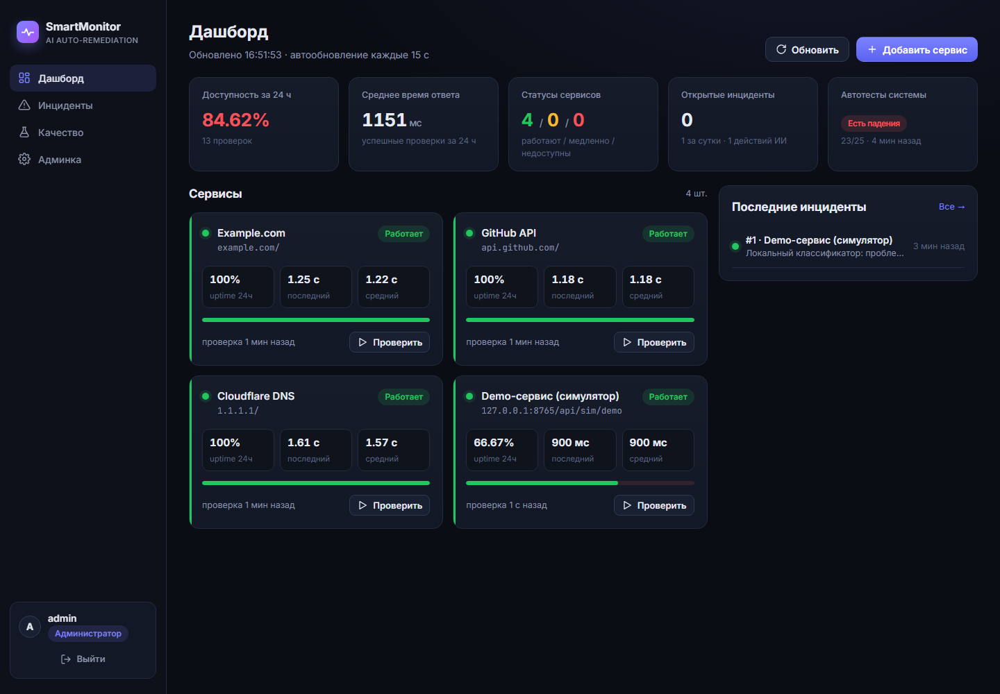
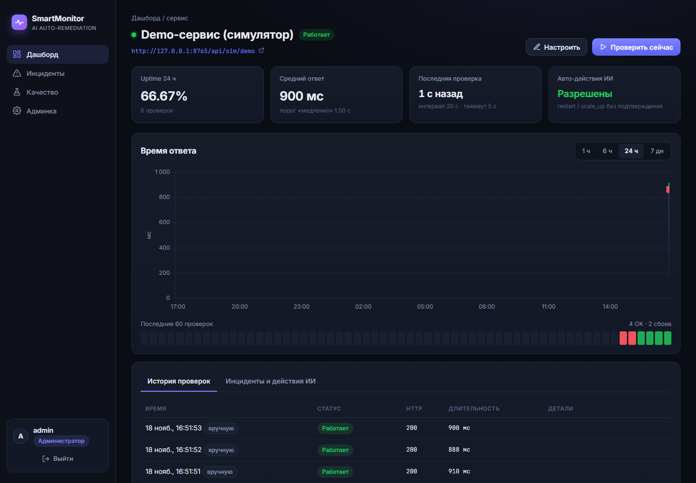
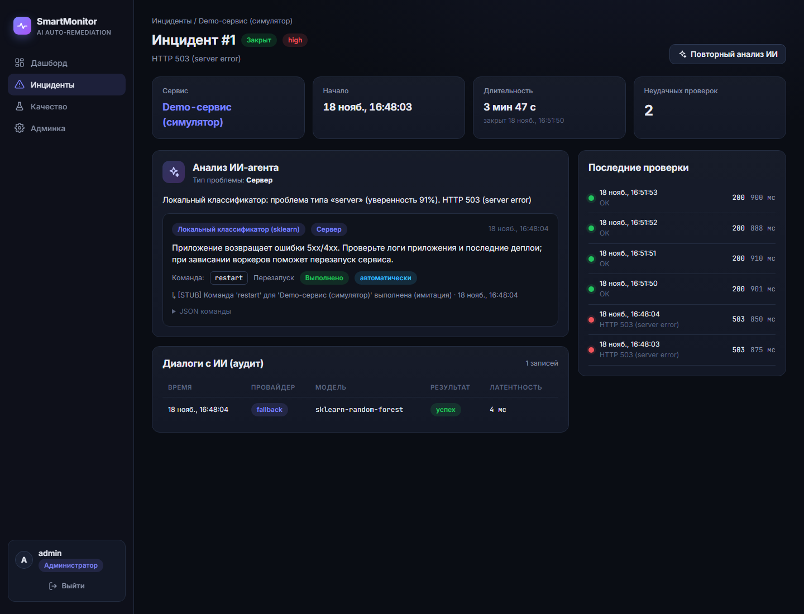
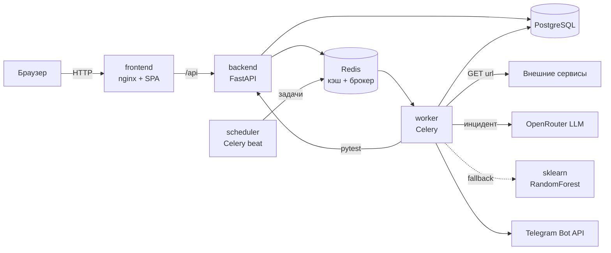
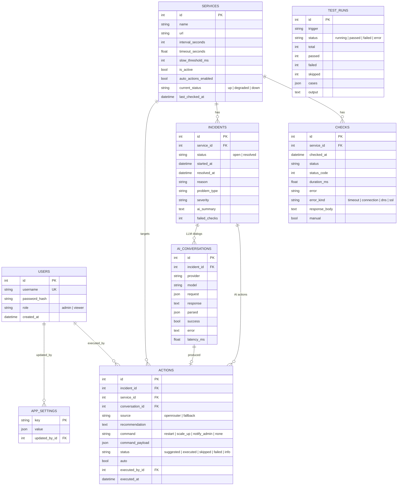

# SmartMonitor — умный мониторинг с автореагированием

Веб-платформа, которая мониторит доступность и скорость внешних URL, при сбое открывает инцидент,
отдаёт его ИИ-агенту (OpenRouter, при недоступности — локальный классификатор scikit-learn),
который предлагает или сам выполняет структурированную команду восстановления.
Всё управляется через сайт с дашбордом, графиками, историей, админкой и дашбордом качества.



| Страница сервиса | Инцидент и решение ИИ-агента |
|---|---|
|  |  |

---

## Быстрый старт

```bash
cp .env.example .env          # необязательно: у всех переменных есть значения по умолчанию
docker compose up --build     # или docker-compose up --build
```

| Что | Адрес |
|---|---|
| Сайт | http://localhost:8080 |
| API (Swagger) | http://localhost:8080/api/docs |
| Вход администратора | `admin` / `admin123` (меняется через `ADMIN_USERNAME` / `ADMIN_PASSWORD`) |

При первом старте создаются администратор и 4 демо-сервиса (`SEED_DEMO=true`), в том числе
**«Demo-сервис (симулятор)»** — встроенный эндпоинт `/api/sim/demo`, которым удобно имитировать сбой.
Через ~40 секунд после старта автоматически проходит первый прогон автотестов системы.

### Демо-сценарий (критерии приёма)

1. Войдите как `admin` → на дашборде видны сервисы с цветными индикаторами.
2. **Админка → Сервисы → Добавить** (или кнопка «Добавить сервис» на дашборде), затем «Проверить» —
   результат сохраняется в БД и появляется на графике страницы сервиса.
3. **Админка → Симулятор сбоев** → для `demo` нажмите «Упал» (503) или «Ошибка БД» (500 + текст ошибки БД).
4. Нажмите «Проверить» у Demo-сервиса дважды (или подождите 2 плановые проверки по 20 с) — откроется инцидент.
5. На странице инцидента появится рекомендация ИИ-агента и команда (`restart` / `scale_up` / `notify_admin`).
6. **Админка → Настройки ИИ** → включите «Разрешить автоматическое выполнение опасных команд»
   (у Demo-сервиса флаг авто-действий уже включён). Следующий инцидент: команда будет выполнена автоматически
   и залогирована как `executed` (журнал — «Админка → Действия агента», файл `logs/agent.log`).
   Без разрешения опасная команда ждёт решения администратора: кнопки «Выполнить» / «Отклонить».
7. Верните режим «Работает» — после первой успешной проверки инцидент закроется.

Весь сценарий автоматизирован: `python scripts/e2e_check.py http://localhost:8080`
(и `--qa` — запустить автотесты и потребовать статус `passed`). Он же выполняется в GitHub Actions
на настоящем `docker compose up --build`.

---

## Архитектура



| Контейнер | Назначение |
|---|---|
| `backend` | FastAPI: REST API, JWT-авторизация, ручные проверки, встроенный симулятор сбоев |
| `frontend` | nginx: отдаёт SPA (HTML + CSS + JS-модули, Chart.js) и проксирует `/api` |
| `postgres` | основная БД |
| `redis` | кэш дашборда (10 с), блокировки, брокер и backend Celery |
| `worker` | Celery worker: проверки сервисов, анализ инцидентов ИИ, автотесты, отчёты |
| `scheduler` | Celery beat: расписание проверок, автотестов, отчётов |

### Структура кода (чистая архитектура)

```
backend/app
├── core/           конфиг (pydantic-settings), БД, Redis-кэш, JWT/хэши, loguru с ротацией
├── models/         ORM-модели SQLAlchemy 2.0 (типизированные Mapped[])
├── schemas/        DTO Pydantic v2 для API и решения ИИ-агента
├── repositories/   доступ к данным — весь SQL только здесь
├── services/       бизнес-логика: monitor, incidents, ai_agent, classifier, executor,
│                   notifications, stats, qa_runner, simulator, jobs, seed
├── api/            роуты FastAPI + зависимости (текущий пользователь, роль admin)
├── worker/         Celery app, beat-расписание, задачи
└── qa/system_tests системные автотесты, которые планировщик запускает раз в час
backend/tests       юнит/интеграционные тесты (SQLite in-memory, без Docker)
frontend/           SPA без сборки: index.html, css/, js/pages/*
scripts/e2e_check.py приёмочный сценарий против запущенного стека
```

---

## Как это работает

### Проверки и инциденты
* Планировщик каждые 10 с запускает `dispatch_due_checks`: для активных сервисов, у которых истёк интервал,
  ставится задача `check_service` (Redis-блокировка исключает дубли).
* Статус проверки: **down** — таймаут, ошибка соединения/DNS/SSL, HTTP ≥ 400;
  **degraded** — ответ дольше порога сервиса или **резкое падение скорости** (в 3 раза медленнее
  среднего по последним успешным проверкам); иначе **up**.
* **Инцидент** открывается после `INCIDENT_THRESHOLD` (по умолчанию 2) неудачных проверок подряд
  и закрывается первой успешной. Открытие ставит задачу анализа ИИ и шлёт уведомление в Telegram.

### ИИ-агент
* Контекст для модели: URL, причина, **последние 5 проверок** (код, длительность, ошибка, фрагмент тела)
  и **история 5 последних действий** по сервису, флаг «разрешены ли авто-действия».
* Модель (по умолчанию `anthropic/claude-3.5-sonnet` через OpenRouter) отвечает строго JSON:
  ```json
  {"problem_type": "server", "severity": "high", "summary": "...", "recommendation": "...",
   "command": {"action": "restart", "target": "api", "params": {}, "reason": "..."}}
  ```
  Ответ валидируется Pydantic (терпим к markdown-обёртке и мусору вокруг JSON; неизвестная команда → `none`).
* **Fallback:** если ключа нет, OpenRouter недоступен или ответ не разобрался — срабатывает
  `RandomForestClassifier` (scikit-learn), обученный на синтетическом датасете по признакам последних проверок
  (доля таймаутов, ошибок соединения, 5xx/502–504, 4xx, ключевые слова БД в теле, средняя латентность)
  и классифицирующий проблему как **сетевую / серверную / БД** с шаблонной рекомендацией и командой.
* **Аудит:** каждый вызов (и удачный, и неудачный — с текстом ошибки) пишется в `ai_conversations`:
  полные сообщения запроса, сырой ответ, разобранное решение, модель, латентность. Видно в админке.
* **Политика выполнения команд** (`services/executor.py`):

  | Команда | Поведение |
  |---|---|
  | `none` | сохраняется как рекомендация |
  | `notify_admin` | безопасная — выполняется сразу (сообщение в Telegram) |
  | `restart`, `scale_up` | выполняются автоматически, **только если** admin включил глобальную галку и флаг у сервиса; иначе статус «ждёт решения», admin жмёт «Выполнить»/«Отклонить» |

  Выполнение — заглушка: запись в аудит-лог `logs/agent.log` + (опционально) POST JSON
  на `ACTION_WEBHOOK_URL`, имитирующий внешний API оркестратора.

### Автоматизация и QA
| Задача | Расписание |
|---|---|
| Проверка сервисов | каждые 10 с отбираются сервисы с истёкшим интервалом |
| Автотесты системы (pytest) | при старте и раз в `SYSTEM_TESTS_INTERVAL_MINUTES` (60) |
| Повторный анализ «забытых» инцидентов | каждые 2 мин |
| Отчёт в Telegram | ежедневно в `REPORT_HOUR_UTC`:00 UTC + кнопка в админке |

Системные автотесты (`backend/app/qa/system_tests`) прогоняются в контейнере worker,
результаты (по каждому тесту, с трейсбеком) сохраняются в таблицу `test_runs` и показываются
на странице **«Качество»**. Набор:
* **API**: health (БД + Redis), авторизация и 401/403, `GET /services`, `POST /checks` сохраняет результат
  и он попадает в историю и график, сквозной сценарий «2 сбоя → инцидент → восстановление» на симуляторе;
* **ИИ-агент на мок-данных**: разбор структурированной команды из ответа LLM (mock-транспорт httpx),
  переход на fallback при мусорном ответе, классификатор на трёх типах сбоев, живой запрос к OpenRouter
  (если задан ключ; отключается `QA_LIVE_LLM=false`);
* **Целостность БД**: наличие таблиц, индексов и внешних ключей, отсутствие «осиротевших» записей,
  не более одного открытого инцидента на сервис, корректность временных меток.

При падении прогона приходит сообщение в Telegram.

### Роли и безопасность
* JWT (HS256) реализован вручную на `hmac`/`hashlib` (`core/security.py`), пароли — PBKDF2-SHA256
  (260 000 итераций, соль).
* **viewer** — регистрируется сам, видит дашборд, графики, историю, инциденты, качество.
* **admin** — CRUD сервисов, ручные проверки, права ИИ-агента, выполнение/отклонение команд,
  логи диалогов с ИИ, симулятор, управление ролями пользователей.

### Логирование
loguru с ротацией: `logs/backend.log`, `logs/worker.log` (10 МБ, хранение 14 дней, zip),
отдельный аудит-лог агента `logs/agent.log` (30 дней). Логи лежат в docker-томе `logs`.

---

## Переменные окружения (.env)

| Переменная | По умолчанию | Описание |
|---|---|---|
| `POSTGRES_USER` / `POSTGRES_PASSWORD` / `POSTGRES_DB` | `smartmonitor` | доступ к PostgreSQL |
| `JWT_SECRET` | `change-me-in-env` | секрет подписи JWT — **обязательно поменять** |
| `JWT_TTL_MINUTES` | `720` | время жизни токена |
| `ADMIN_USERNAME` / `ADMIN_PASSWORD` | `admin` / `admin123` | администратор, создаётся при первом старте |
| `OPENROUTER_API_KEY` | — | ключ OpenRouter; без него работает fallback-классификатор |
| `OPENROUTER_MODEL` | `anthropic/claude-3.5-sonnet` | любая модель OpenRouter, напр. `google/gemini-pro-1.5` |
| `TELEGRAM_BOT_TOKEN` / `TELEGRAM_CHAT_ID` | — | отчёты и уведомления в Telegram |
| `REPORT_HOUR_UTC` | `9` | час ежедневного отчёта (UTC) |
| `INCIDENT_THRESHOLD` | `2` | сколько неудачных проверок подряд открывают инцидент |
| `SYSTEM_TESTS_INTERVAL_MINUTES` | `60` | период автотестов |
| `ACTION_WEBHOOK_URL` | — | внешний API, получающий выполненные команды агента (POST JSON) |
| `QA_LIVE_LLM` | `true` | делать ли живой запрос к OpenRouter в автотестах |
| `SEED_DEMO` | `true` | создать демо-сервисы при пустой БД |
| `LOG_LEVEL` | `INFO` | уровень логирования |
| `FRONTEND_PORT` / `BACKEND_PORT` | `8080` / `8000` | порты на хосте |

---

## Схема БД



Индексы: `ix_checks_service_checked (service_id, checked_at)`, `ix_incidents_service_status`,
уникальный `ix_users_username`, а также по `checked_at`, `incidents.status`, `actions.incident_id` и др.
Каскадное удаление: сервис → проверки, инциденты, действия, диалоги.

---

## API (основное)

| Метод и путь | Роль | Описание |
|---|---|---|
| `POST /api/auth/register`, `POST /api/auth/login`, `GET /api/auth/me` | — | регистрация (viewer), вход, профиль |
| `GET /api/services` | viewer | сервисы со статистикой за 24 ч |
| `POST/PUT/DELETE /api/services/{id}` | admin | управление сервисами |
| `POST /api/services/{id}/check`, `POST /api/checks` | admin | ручная проверка |
| `GET /api/services/{id}/checks?page=&size=` | viewer | история проверок с пагинацией |
| `GET /api/services/{id}/timeseries?hours=24` | viewer | данные графика |
| `GET /api/incidents`, `GET /api/incidents/{id}` | viewer | инциденты, действия ИИ, последние проверки |
| `POST /api/incidents/{id}/analyze`, `.../resolve` | admin | повторный анализ ИИ, ручное закрытие |
| `POST /api/actions/{id}/execute`, `.../reject` | admin | подтвердить / отклонить команду агента |
| `GET /api/ai/conversations[/{id}]` | admin | аудит диалогов с ИИ |
| `GET/PUT /api/settings` | viewer / admin | права ИИ-агента, уведомления |
| `GET /api/qa/runs[/{id}]`, `POST /api/qa/runs` | viewer / admin | автотесты |
| `GET /api/stats/summary` | viewer | сводка для дашборда |
| `POST /api/reports/telegram` | admin | отправить отчёт сейчас |
| `GET /api/sim/{name}`, `PUT /api/sim/{name}` | — / admin | симулятор внешнего сервиса |

Полная спецификация — Swagger на `/api/docs`.

---

## Разработка и тесты

```bash
cd backend
python -m venv .venv && . .venv/bin/activate      # Windows: .venv\Scripts\activate
pip install -r requirements.txt
python -m pytest -q                                # 20 тестов, SQLite in-memory, без Docker

# локальный запуск без Docker: SQLite, фоновые задачи в потоках, SPA раздаёт FastAPI
DATABASE_URL=sqlite:///./dev.db CELERY_EAGER=true FRONTEND_DIR=../frontend \
BACKEND_INTERNAL_URL=http://127.0.0.1:8000 uvicorn app.main:app --port 8000
```

CI (`.github/workflows/ci.yml`): юнит-тесты → `docker compose up --build` → приёмочный сценарий
`scripts/e2e_check.py` → прогон системных автотестов внутри worker с требованием `passed`.
